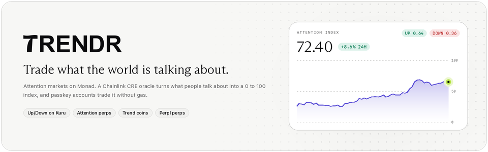

<picture>
  <source media="(prefers-color-scheme: dark)" srcset="assets/readme/hero-dark.png">
  <source media="(prefers-color-scheme: light)" srcset="assets/readme/hero-light.png">
  
</picture>

**Trendr turns what the internet is talking about into markets you can trade from your phone, on Monad.**

**Technical demo:** [link] · **Pitch demo:** [link] · **Website:** [trendr.bid](https://trendr.bid) · **App:** [app.trendr.bid](https://app.trendr.bid) · **X:** [@trendrnow](https://x.com/trendrnow) · **Contracts:** [Monadscan](#deployed-contracts-on-monad-testnet)

Built for Monad Metropolis, Track 01.

## What it is

A radar watches X, Telegram, Bluesky, CoinGecko, GeckoTerminal and Wikipedia for topics that are taking off, and an AI review plus a human admin decide which become trends.
A Chainlink CRE workflow measures each trend's attention from Elfa, GDELT, Wikipedia, Nansen, Bluesky and Hacker News and writes a 0 to 100 attention index to Monad.
Every trend then gets markets on that index: Up/Down outcome series on Kuru, attention perps and a trend coin on a bonding curve, next to Perpl perps on the underlying asset.
Users sign up with a passkey, never see a seed phrase or a gas fee, and trade with one prompt a week thanks to guarded session keys.
The contracts are live and verified on Monad Testnet, and the mobile-first PWA and its eight services run against them.
Mainnet is next: the app and the website collect emails for its launch and beta on a waitlist.

## Features

**Trade attention**
- **Up/Down series on Kuru**: fully collateralized UP and DOWN tokens per trend for 24 hours and 7 days, each with one canonical Kuru order book against AUSD; a complete set always redeems for 1 AUSD.
- **Attention perps**: isolated-margin perps on the index itself, up to 3x, with per-block funding from long/short skew.
- **Trend coins**: one coin per trend on a constant-product bonding curve whose floor ratchets with peak attention, graduating to its own Kuru market.
- **Perpl perps**: trade the asset behind a trend (BTC, ETH, SOL, MON and more) on Perpl from the same account.

**Automate and follow**
- **Autopilot**: rules like "attention up 40% in 4 hours and smart money buying, go long 3x" that open Perpl positions with stop-loss, take-profit and loss limits, backtested on the real index history.
- **Copy-trading**: follow Perpl leaders with ratio or fixed margin, a leverage cap, a daily loss cap and slippage protection.

**Social**
- **Calls**: public Up or Down predictions on a trend, signed by a caller identity that stays unlinkable from the trading account, ranked by hit rate on a leaderboard.
- **Curation reward**: the account that first surfaced a trend earns a share of its perp and curve fees, on chain in `CurationFees`.
- **Share cards**: images for calls and for PnL, where attention-perp results are verified from the on-chain close event.

**Account and phone**
- **Mera passkeys**: one passkey derives the account, its trading session key, a caller identity, a vault key and a Perpl API key.
- **Gas-free**: a relayer pays for every allowlisted Trendr call.
- **PWA and push**: installable, with Web Push for Autopilot and copy-trading activity, calls and markets.
- **Any-chain deposits**: Aurora Intents brings value from about 35 chains into AUSD (Mainnet, see [docs/aurora.md](docs/aurora.md)).
- **Mainnet waitlist**: an email form in the app and on the website; nothing is sent until Mainnet launches.

## How it works

<picture>
  <source media="(prefers-color-scheme: dark)" srcset="assets/readme/architecture-light.png">
  <source media="(prefers-color-scheme: light)" srcset="assets/readme/architecture-dark.png">
  
</picture>

Trends start in the **backend** radar: Elfa trending tokens and narratives, CoinGecko's most-searched coins, GeckoTerminal's trending pools, Bluesky's trending topics, Wikipedia's most-read articles and pasted links become candidates, reviewed by Gemini, then OpenAI, then Kimi, and approved automatically at high confidence or by an admin.
The backend collector reads each trend's attention from Elfa, GDELT, Wikipedia, Nansen, Bluesky and Hacker News at the pace each source allows.
The **CRE workflow** pulls the approved queue, measures it and decides under consensus which candidates become trends; only its forwarder can write to `TrendRegistry`.
Bun **services** run everything around the contracts: the keeper opens, lists, settles, liquidates and graduates, the market maker quotes Kuru from the first block, Autopilot trades rules and copies, top-up refills every service wallet, and the Envio indexer builds portfolios and track records.

<picture>
  <source media="(prefers-color-scheme: dark)" srcset="assets/readme/trade-life-light.png">
  <source media="(prefers-color-scheme: light)" srcset="assets/readme/trade-life-dark.png">
  
</picture>

<picture>
  <source media="(prefers-color-scheme: dark)" srcset="assets/readme/index-pipeline-light.png">
  <source media="(prefers-color-scheme: light)" srcset="assets/readme/index-pipeline-dark.png">
  
</picture>

The index method, with every formula and budget, is in [apps/cre-oracle/docs/index-method.md](apps/cre-oracle/docs/index-method.md).
Until Chainlink grants deploy access, Testnet runs the same workflow with `cre workflow simulate --broadcast` every minute through Chainlink's MockKeystoneForwarder, and the registry trusts only that broadcaster.

<picture>
  <source media="(prefers-color-scheme: dark)" srcset="assets/readme/security-light.png">
  <source media="(prefers-color-scheme: light)" srcset="assets/readme/security-dark.png">
  
</picture>

## Deployed contracts on Monad Testnet

Chain id 10143, start block 69452198, addresses from [contracts/deployments/10143.json](contracts/deployments/10143.json).
Every Trendr contract is verified on Monadscan and Sourcify, ownerless and non-upgradeable ([contracts/README.md](contracts/README.md)).

| Contract | Role | Address |
|---|---|---|
| TrendRegistry | Trends, index checkpoints and settlement values; only the CRE forwarder writes | [`0xa24F779B6ae73bD7d6d1a2fE47B9EF9EA7bD805c`](https://testnet.monadscan.com/address/0xa24F779B6ae73bD7d6d1a2fE47B9EF9EA7bD805c) |
| OutcomeMarkets | UP/DOWN tokens per trend and window, complete sets for 1 AUSD | [`0x8eaa2Dd6B3890Ead77BA9f555378eD11310C3EBF`](https://testnet.monadscan.com/address/0x8eaa2Dd6B3890Ead77BA9f555378eD11310C3EBF) |
| OutcomeListing | The canonical Kuru market of each UP and DOWN token | [`0x774AffCB8f4B095100B3C46bF562214BF30e9E7E`](https://testnet.monadscan.com/address/0x774AffCB8f4B095100B3C46bF562214BF30e9E7E) |
| AttentionPerp | Isolated-margin perps on the index | [`0xeEC85F72e63EE5DAF66d285182241244110E0C84`](https://testnet.monadscan.com/address/0xeEC85F72e63EE5DAF66d285182241244110E0C84) |
| BondingCurve | Trend coins on curves | [`0x597e4ad49b2430Ed8D4543eb46f94189231534DF`](https://testnet.monadscan.com/address/0x597e4ad49b2430Ed8D4543eb46f94189231534DF) |
| KuruGraduationVenue | Lists a graduated coin on Kuru and seeds its vault | [`0x7D9e0b3145882e513Ee24D912DB1f4479DDBC7d3`](https://testnet.monadscan.com/address/0x7D9e0b3145882e513Ee24D912DB1f4479DDBC7d3) |
| CurationFees | Fee share for the account that surfaced a trend | [`0x529d9B1e685BD943053Dc356D40a368639646168`](https://testnet.monadscan.com/address/0x529d9B1e685BD943053Dc356D40a368639646168) |
| PasskeyAccount v2 | EIP-7702 delegate: passkey owner, guarded sessions, gross daily limit | [`0xa3023591e43085c782444937F96f2B82E98B2524`](https://testnet.monadscan.com/address/0xa3023591e43085c782444937F96f2B82E98B2524) |
| PerplOrderGuard | Session Perpl orders within 2% of mark, at most 10x | [`0xC102deFE8E35dE8B73016CAe9806141456f2d09b`](https://testnet.monadscan.com/address/0xC102deFE8E35dE8B73016CAe9806141456f2d09b) |
| TrendrSpot | Kuru spot routing through canonical markets only | [`0x8daBA0D411D3530819B5FD1520A79050c0FEb374`](https://testnet.monadscan.com/address/0x8daBA0D411D3530819B5FD1520A79050c0FEb374) |
| TrendrLens | Batched read-only views for the oracle, keeper and app | [`0xC7171c3cfe1efFBBa8e387334a03231267121d5A`](https://testnet.monadscan.com/address/0xC7171c3cfe1efFBBa8e387334a03231267121d5A) |
| AUSD (external, Agora) | Settlement collateral | [`0xa9012a055bd4e0eDfF8Ce09f960291C09D5322dC`](https://testnet.monadscan.com/address/0xa9012a055bd4e0eDfF8Ce09f960291C09D5322dC) |
| Kuru Router (external) | Kuru market deployment and swaps | [`0x7EFbE105Ca7415dE98F96622173458ac1c054630`](https://testnet.monadscan.com/address/0x7EFbE105Ca7415dE98F96622173458ac1c054630) |
| Perpl Exchange (external) | Perpl perpetuals | [`0x1964C32f0bE608E7D29302AFF5E61268E72080cc`](https://testnet.monadscan.com/address/0x1964C32f0bE608E7D29302AFF5E61268E72080cc) |
| CRE MockKeystoneForwarder (external, Chainlink) | Delivers the oracle's reports to TrendRegistry | [`0xB9F79d863261869B234c481D1f9A7af84AeAd192`](https://testnet.monadscan.com/address/0xB9F79d863261869B234c481D1f9A7af84AeAd192) |
| Treasury (Testnet wallet) | Receives protocol fees | [`0xda55F7263b7e4D9B36b2F542EEC99fc3b5Dfae7a`](https://testnet.monadscan.com/address/0xda55F7263b7e4D9B36b2F542EEC99fc3b5Dfae7a) |

## Bounty tracks

| Bounty | How Trendr meets it |
|---|---|
| Agora: mobile trading | AUSD is the collateral of every Trendr market; the app is a phone-first PWA with passkey sign-up, bottom navigation, push and a Testnet AUSD faucet. |
| Kuru: new assets | Attention outcome tokens are a new asset class on Kuru: each UP and DOWN token gets one canonical AUSD market through `OutcomeListing`, and graduated trend coins list through `KuruGraduationVenue` ([docs/kuru-attention-contracts.md](docs/kuru-attention-contracts.md)). |
| Kuru: consumer | Every outcome trade in the app routes through Kuru via `TrendrSpot`, priced from a live Kuru book, with a market maker quoting UP and DOWN from the first block. |
| Perpl API | Accounts trade Perpl perps on chain behind `PerplOrderGuard`, the backend serves Perpl market data and candles, and Autopilot runs rules and copy-trading on Perpl, with its bot able to trade through Perpl's signed API (`packages/perpl`). |
| Chainlink CRE | The attention index is a CRE workflow with median consensus across nodes and a signed report to `TrendRegistry`; on Testnet it runs by simulation with `--broadcast` until deploy access is granted. |
| Nansen | Smart-money net flow is an index component, gates new crypto trends, filters Autopilot rules and appears on every crypto trend. |
| Mera: UX | Sign-up is one passkey prompt with no seed phrase and no gas; a session key then signs trades silently for a week. |
| Mera: Many Keys | One passkey's PRF output derives the account key, the session key, an unlinkable caller identity, a vault key and a Perpl Ed25519 key; a new device with the same passkey rebuilds them all (`frontend/e2e/mera-keys.live.spec.ts`). |
| Aurora Intents | `packages/aurora` covers the Swap API, persistent deposit addresses and Intents Connect recipes, and the deposit page converts USDC to AUSD; it targets Mainnet, where quotes and the conversion were verified read-only and on a fork ([docs/aurora.md](docs/aurora.md)). |
| Envio | A HyperIndex indexer follows every Trendr contract, Kuru markets and Trendr accounts on Perpl, and builds portfolios, leaderboards, track records and curation earnings ([indexer/README.md](indexer/README.md)). |

## Tech stack

- **Chain**: Monad (Testnet 10143, Mainnet 143), AUSD settlement, EIP-7702 accounts with the P256 precompile.
- **Contracts**: Solidity 0.8.30, Foundry, OpenZeppelin, Slither.
- **Oracle**: Chainlink CRE TypeScript SDK (QuickJS WASM), Bun.
- **App and admin**: Next.js 16, React 19, Tailwind CSS 4, viem, Mera passkeys, Lightweight Charts.
- **Landing page**: Next.js 15.
- **Backend and services**: Bun, Hono, viem, Postgres, zod.
- **Indexer**: Envio HyperIndex, HyperSync for history and RPC at the head.
- **Hosting (planned)**: Railway for services, Vercel for apps.

## Security model

- **Guarded sessions**: a session key expires (7 days by default, at most 30 through the relayer) and can only call allowlisted targets and selectors, optionally with a pinned recipient.
- **Price guards**: `TrendrSpot` refuses session trades more than 0.10 AUSD from the attention-implied value, and `PerplOrderGuard` refuses orders more than 2% from a Perpl mark older than two minutes, or above 10x.
- **Gross daily limit**: every call's AUSD outflow counts against the session's daily limit, and inflows never offset it.
- **Owner only**: withdrawals, adding margin, trend coins, limit orders, Perpl cancels, new sessions and Autopilot keys need the passkey, verified on chain.
- **Owner approvals**: following a trader, enabling an Autopilot rule and linking a caller identity need a passkey signature over a single-use backend nonce.
- **Activation tickets**: the relayer pays to activate a new account only with a backend-signed ticket, limited per IP and per hour.
- **Relayer budgets**: gas per account per day, total gas per hour, activations per hour and a cooldown after repeated reverts.
- **Autopilot keys**: a Perpl-only session key, sealed in the browser to the executor's public key; the API stores only ciphertext.
- **Audits and tests**: Slither in CI (fails on medium), 32 planted mutations that the suite must catch, 5 invariant suites with 32 invariants and coverage reporting (`INVARIANT_COVERAGE=true`), and a nightly Mainnet fork rehearsal.

## Run it locally

**Prerequisites**: Bun 1.4.2, Node 22.15 or newer, pnpm 10.7, Foundry 1.8.1, Postgres, and the CRE CLI 1.35.0 signed in with `cre login` for the oracle.
Each service needs its own Testnet key with some MON.

**Environment**: copy every `.env.example` to `.env` (`.env.local` in `frontend/` and `admin/`) and fill in the keys.
The backend example names three databases: `trendr`, `trendr_test` and `trendr_envio`.

**Start order**, after `bun install` (or `pnpm install` for the indexer and oracle, `npm ci` for the web apps) in each folder:

| Order | Service | Command | Port |
|---|---|---|---|
| 1 | Postgres | your local server | 5432 |
| 2 | Backend (runs migrations on start) | `cd backend && bun run dev` | 4000 |
| 3 | Indexer | `cd indexer && pnpm start` | 9898 (health) |
| 4 | Relayer | `cd apps/relayer && bun run dev` | 4100 |
| 5 | Keeper | `cd apps/keeper && bun run dev` | 4200 |
| 6 | Market maker | `cd apps/market-maker && bun run dev` | 4300 |
| 7 | Autopilot | `cd apps/autopilot && bun run dev` | 4400 |
| 8 | Top-up | `cd apps/topup && bun run dev` | 4500 |
| 9 | Oracle loop | `cd apps/cre-oracle && pnpm setup && pnpm cre:loop` | |
| 10 | App | `cd frontend && npm run dev` | 3000 |
| 11 | Admin | `cd admin && npm run dev` | 3001 |

The landing page also defaults to port 3000, so run it on its own or with `-p`.

**Other commands**

```bash
cd contracts && forge build && forge test          # contracts
cd packages/contracts-ts && bun run generate       # after a contract change, then bun install in each service
cd apps/cre-oracle && pnpm cre:simulate            # one dry run; add --broadcast for a real Testnet report
cd backend && npx tsc --noEmit                     # backend typecheck
cd frontend && npm run build                       # app production build
```

## Tests

Counted from a run of each suite on 2026-10-11, and on 2026-10-13 for the backend, frontend unit and indexer suites.

| Suite | Tests |
|---|---|
| contracts | 207 forge tests: unit, fuzz and invariants, plus 4 fork rehearsal tests (Testnet and Mainnet forks) and 32 planted mutations |
| backend | 268 |
| relayer | 82, plus 10 end-to-end on Anvil |
| aurora | 99, plus 6 against live Aurora APIs |
| CRE oracle | 73 |
| topup | 52, plus 3 end-to-end on Anvil |
| autopilot | 32 |
| indexer | 24 |
| market maker | 22 |
| keeper | 20 |
| packages | 86 (`autopilot` 29, `contracts-ts` 31, `chain` 19, `perpl` 7) |
| frontend | 80 unit tests; 16 Playwright on Anvil; live Testnet Playwright suites: trend 1, live 6, portfolio 17 |
| admin | 21 Playwright |

CI runs the contracts, backend, app, admin, indexer, oracle, Aurora, relayer, keeper, market maker and top-up suites, plus a nightly Mainnet fork rehearsal ([.github/workflows](.github/workflows)).

## Mainnet readiness

Nothing is on Mainnet yet.
A full deploy was rehearsed on an Anvil fork of Mainnet with the real AUSD, Kuru, Perpl, CRE forwarders and P256 precompile, and runs nightly.
Mainnet goes live one product at a time: contracts and the oracle first, then attention perps, trend coins, Perpl and Aurora deposits, with Up/Down on Kuru last because Kuru's Safe must deploy each series' markets.
[docs/mainnet.md](docs/mainnet.md) has the runbook, the measured MON budget and what the rehearsal found.

## Sources and credits

- [Monad](https://www.monad.xyz): the chain.
- [Chainlink CRE](https://docs.chain.link/cre): the attention index workflow.
- [Kuru](https://www.kuru.io): order books for outcome tokens and graduated coins.
- [Perpl](https://perpl.xyz): perpetuals and the trading API.
- [Agora AUSD](https://www.agora.finance): settlement collateral.
- [Aurora Intents](https://aurora.dev): any-chain deposits.
- [Envio](https://envio.dev): the indexer.
- [Mera](https://www.npmjs.com/package/@category-labs/mera): passkey accounts.
- [Elfa AI](https://www.elfa.ai): mentions on X and Telegram, and trending topics.
- [Wikimedia pageviews](https://wikitech.wikimedia.org/wiki/Data_Platform/AQS/Pageviews): article views and most-read lists.
- [Nansen](https://www.nansen.ai): smart-money flows.
- [GDELT](https://www.gdeltproject.org): worldwide news coverage.
- [Bluesky](https://docs.bsky.app): posts and trending topics.
- [Hacker News](https://hn.algolia.com/api) through Algolia's search API: stories and comments.
- [CoinGecko](https://www.coingecko.com) and [GeckoTerminal](https://www.geckoterminal.com): most-searched coins and trending pools for the radar.
- [Gemini](https://ai.google.dev), [OpenAI](https://platform.openai.com) and [Kimi](https://platform.moonshot.ai): candidate review.
- Demo activity: a few project-owned Testnet accounts made test transactions so the markets, leaderboards and threads show the product in use.

Built by aliyaan.

## AI tools

Built with the help of AI coding tools: Claude and Codex.

## License

MIT, see [LICENSE](LICENSE).
